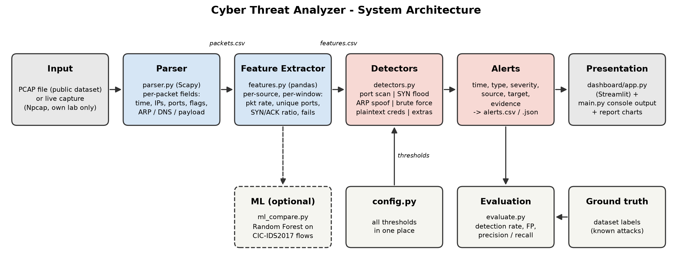

# System Design Summary – Analysis of Cyber Threats and Attacks in Data Traffic

## 1. Objective
Build a Python tool that reads network traffic (PCAP files, or live capture inside an isolated lab),
detects at least five common attacks using explainable rules, and reports each finding with its
timestamp, source, target, attack type, severity and evidence, through a CLI and a Streamlit dashboard.

## 2. Architecture

**Data flow:** PCAP → `parser.py` (Scapy, one row per packet → `packets.csv`) → `features.py`
(pandas, per-source statistics in fixed 10-second windows → `features.csv`) → `detectors.py`
(one rule per attack, thresholds from `config.py`) → alerts (`alerts.csv` / `alerts.json`) →
`main.py` console output and `dashboard/app.py`. `evaluate.py` compares alerts with dataset ground truth.

## 3. Modules
| Module | Responsibility |
|---|---|
| `src/config.py` | All detection thresholds and port lists in one place |
| `src/parser.py` | Read PCAP; extract time, MACs, IPs, ports, protocol, TCP flags, length, ARP, DNS, payload |
| `src/features.py` | Per-source / per-window stats: packet rate, unique dst ports, SYN/ACK ratio, failed logins |
| `src/detectors.py` | One function per attack; returns a list of alerts |
| `src/main.py` | CLI: `python src/main.py --pcap file.pcap` → print and save alerts |
| `src/evaluate.py` | Detection rate, false positives, precision/recall against ground-truth labels |
| `src/ml_compare.py` | (Optional) Random Forest on CIC-IDS2017 flow features for comparison |
| `dashboard/app.py` | Streamlit UI: upload PCAP, traffic overview, alerts table, evidence drill-down |

## 4. Detection rules
| Attack | OSI layer | Indicator | Threshold | Why it works |
|---|---|---|---|---|
| Port scan | L4 Transport | Distinct dst ports one source contacts on one host | ≥ 20 ports in 10 s | Normal clients use a few known ports; reconnaissance sweeps many |
| SYN flood (DoS) | L4 Transport | Peak SYN/s to one target, completed-handshake ratio, ports targeted | ≥ 100 SYN/s **and** ACK/SYN < 0.2 **and** ≤ 5 ports | Flood leaves handshakes half-open to exhaust the server's backlog; many ports would mean a scan instead |
| ARP spoofing | L2 Data link | Number of MACs claiming one IP in ARP replies | > 1 MAC per IP (Critical if gateway) | A legitimate IP has one MAC; a second MAC means poisoning / MITM |
| Brute-force login | L7 (seen at L4) | New connections to 21/22/23/3389; FTP 530 / HTTP 401 replies | ≥ 10 attempts or ≥ 5 failures in 60 s | Humans log in a few times; tools try passwords at machine speed. Port 80 is judged by 401 replies only, because browsers open many connections |
| Plaintext credentials | L7 Application | FTP `USER`/`PASS`, Telnet login, HTTP `Authorization: Basic`, POST `password=` | Any 1 occurrence | Unencrypted protocols expose secrets to anyone on the path |
| DNS tunneling (extra) | L7 Application | Unique query names that are long or high-entropy | ≥ 5 unique names with > 50 chars or entropy > 3.5 bits/char | Tunnelled data makes long, random labels that never repeat (CDN names repeat) |
| ICMP flood (extra) | L3 Network | Echo-request rate to one target | ≥ 100 /s | Volumetric DoS using ping |
| Unusual ports (extra) | L4 Transport | Traffic to known backdoor/C2 ports | 4444, 1337, 31337, 6667, 12345 | Common defaults for reverse shells and botnets |

## 5. Alert format
`timestamp | attack_type | severity (Low/Medium/High/Critical) | src | dst | evidence`
Example: `10:42:07 | Port Scan | Medium | 192.168.56.101 | 192.168.56.20 | 312 distinct ports in 10 s (SYN only, 298 RST replies)`
Credentials found in evidence are masked (e.g. `p*****`) for ethical handling.

## 6. Design decisions
- **Rule-based first:** each alert can be explained (good for analysis and the demo), and no training data is needed. ML is an optional comparison.
- **Fixed time windows (10 s / 60 s):** simple and fast with pandas `groupby`. Known weakness: slow scans spread over windows can evade detection (discussed in Limitations).
- **Configurable thresholds:** chosen from protocol behaviour, then tuned on normal vs attack PCAPs in evaluation.
- **Safety:** only public datasets or traffic generated in an isolated VirtualBox host-only lab.
